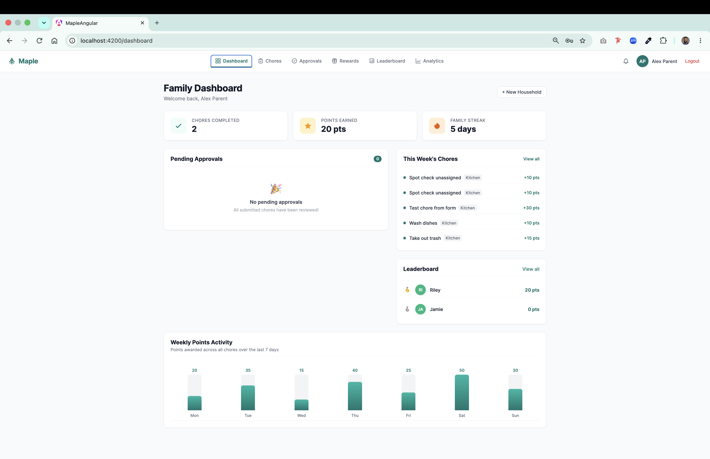
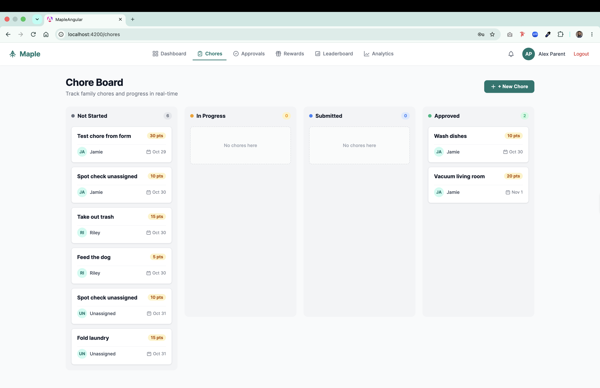
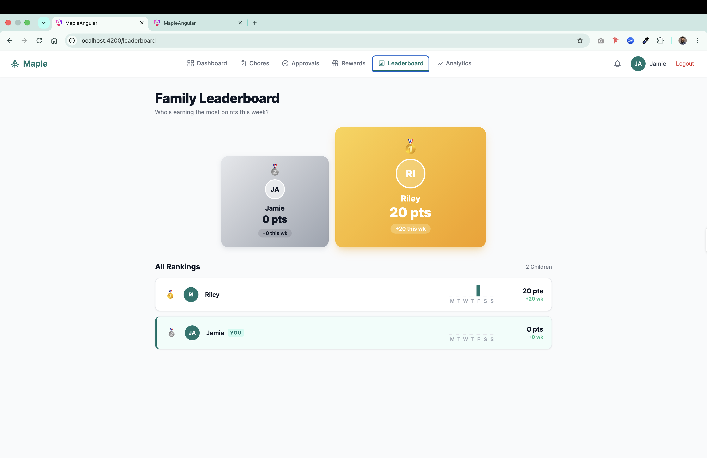
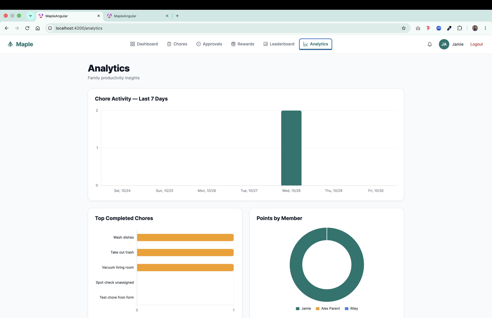
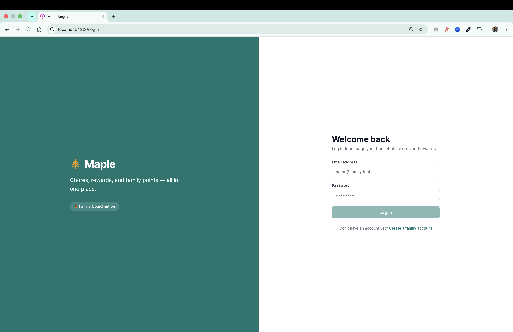
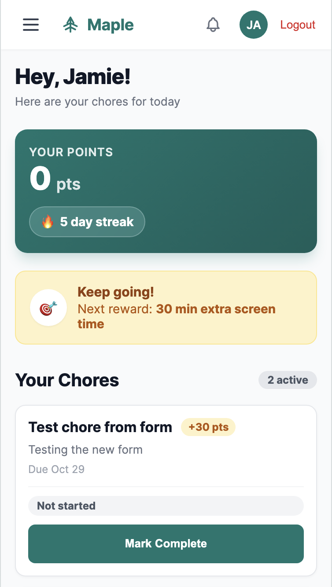

<div align="center">
  <h1>🍁 Maple — Family Chore & Reward Management System</h1>
  <p><b>Enterprise-Grade Full-Stack Household Productivity Platform & Gamified Reward Engine</b></p>

  <p>
    
    
    
    
    
    
    
  </p>

  <p>
    <i>A modern, responsive full-stack web application engineered to streamline family household coordination, enforce accountability, and motivate children through auditable points ledgers and gamified rewards.</i>
  </p>
</div>

---

## 📌 Executive Overview

**Maple** is a production-grade full-stack family coordination platform and chore gamification system. Traditional household management frequently relies on scattered text messages, paper chore charts, and verbal promises—leading to dropped chores, unverified claims, uneven workload distribution, and friction between parents and children.

Maple addresses this challenge by providing a centralized, role-based web application with:
- **Parent Command Center**: Oversee household productivity, create and assign chores, review proof of completion, manage the reward catalog, and analyze engagement trends.
- **Child Experience**: Track personalized daily chores, submit completion notes, monitor points progression in real time, and redeem points for family rewards.
- **Double-Entry Financial-Grade Ledger**: All point allocations and redemptions are recorded as immutable transactions (`SUM(delta)`), preventing desynchronization, race conditions, or balance tampering.
- **Reactive Design System**: Built with modern Angular 17 Signals, standalone components, dynamic Chart.js data visualization, and an adaptive layout optimized across mobile (375px), tablet (768px), and desktop (1440px).

---

## 🎥 Video Walkthrough Demo

Experience a comprehensive product demonstration featuring real-time authentication, dual-role workflows (Parent vs. Child), the Kanban chore board, atomic point ledger transactions, interactive leaderboard sparklines, and dynamic data analytics.

> 🎬 **Walkthrough Video**: See [`docs/DEMO_SCRIPT.md`](docs/DEMO_SCRIPT.md) for the shot-by-shot walkthrough script, voiceover narration, and feature demonstrations.

<details>
<summary><strong>Click to expand feature breakdown & video highlights</strong></summary>
<br />

- **00:00 - 00:45**: Split-screen authentication & secure session handshake.
- **00:45 - 01:30**: Parent Dashboard KPIs, pending approval queues, and weekly volume charts.
- **01:30 - 02:15**: Interactive Kanban Chore Board with status transitions and child assignment.
- **02:15 - 03:00**: Child experience—submitting chore completion notes & reviewing real-time points.
- **03:00 - 03:45**: Two-sided verification—parent approval workflow & atomic points transaction ledger.
- **03:45 - 04:30**: Rewards store redemption with balance validation, podium leaderboard, and Chart.js analytics.
</details>

---

## 📱 Visual Showcase

| Parent Dashboard & KPIs | Kanban Chore Board | Approvals Queue |
|:---:|:---:|:---:|
|  |  |  |

| Rewards Store & Redemptions | Child Personal Dashboard | Dynamic Family Leaderboard |
|:---:|:---:|:---:|
|  |  |  |

| Chart.js Visual Analytics | Split-Screen Auth & Onboarding | Mobile Responsive Layout (375px) |
|:---:|:---:|:---:|
|  |  |  |

---

## ✨ Key Capabilities

### 1. Multi-Tenant Households & Role-Based Access Control
- **Dual Household Roles**: Granular permission gating separating `parent` (administrative authority, chore/reward CRUD, approvals) from `child` (completion submission, catalog redemption, leaderboard participation).
- **Secure Session Authentication**: PHP session-backed cookies with `SameSite`, `HttpOnly`, and secure attributes, coupled with password hashing (`PASSWORD_DEFAULT` Bcrypt).
- **Multi-Household Architecture**: Support for household creation and member invitation codes, allowing users to belong to different family units with isolated scopes.

### 2. Kanban Chore Board & Lifecycle Workflow
- **4-Stage State Machine**: Chores progress cleanly through `Not Started` ➔ `In Progress` ➔ `Submitted` ➔ `Approved`.
- **Flexible Assignment Engine**: Assign tasks to specific children, define point values, set strict due dates, and categorize by room or responsibility area.
- **Parent Oversight & Reassignment**: Reassign active tasks or adjust due dates on the fly with live status synchronizations.

### 3. Two-Sided Verification & Auditable Approval Queue
- **Accountability Submissions**: Children submit completion requests with accompanying notes detailing their work.
- **Parent Review Gate**: Parents can approve with a single click (triggering atomic points awards) or reject with explicit feedback notes so the child can address deficiencies.
- **State Guarding**: Strict backend validation ensures approvals only operate on records in `pending` status, eliminating replay attacks or double-credit bugs.

### 4. Immutable Append-Only Points Ledger
- **Financial-Grade Ledger Pattern**: Balances are never updated in place. Instead, all rewards, deductions, and adjustments are recorded as discrete entries in `points_transactions`.
- **Computed Real-Time Balances**: User point balances are calculated dynamically using `SUM(delta)`, providing a tamper-proof audit trail of every point earned and spent.
- **Balance Protection**: Re-validates child point balances within a transaction before finalizing reward redemptions to prevent negative balances.

### 5. Gamified Reward Store & Milestone Redemption
- **Custom Reward Catalog**: Parents configure real-world rewards (e.g., screen time, outings, toys, privilege tokens) with point thresholds.
- **Child Storefront**: Children browse available rewards with dynamic visual affordability badges and balance indicators.
- **Redemption Workflow**: Redemptions trigger pending requests that parents approve, immediately deducting points and logging the event in the ledger.

### 6. Dynamic Family Leaderboard & Activity Metrics
- **Interactive Podium**: Highlight top contributors with Gold, Silver, and Bronze badges.
- **Performance Sparklines**: Inline activity trends visualising 7-day contribution momentum.
- **Contextual Identity**: Clear "YOU" indicator distinguishing the logged-in family member.

### 7. Rich Analytics & Visual Intelligence
- **Weekly Activity Chart**: Bar chart tracking household chore completions by day.
- **Chore Distribution**: Horizontal bar chart identifying most frequently completed chores.
- **Points Breakdown**: Doughnut chart showcasing point contributions across all family members.

### 8. Mobile-First Responsive Design System
- **Curated Design Palette**: Deep Sage Teal (`#0F766E`), Warm Amber (`#F59E0B`), and Slate neutrals designed in Figma.
- **Fluid Layouts**: Full viewport responsiveness tailored for 375px mobile phones, 768px tablets, and 1440px desktop workstations.
- **Accessible State Handling**: Standardized loading skeletons, informative empty states, and toast feedback for seamless user experience.

---

## 🏗️ System Architecture & Data Flow

```mermaid
flowchart TD
    subgraph Client ["🎨 Frontend Client (Angular 17 SPA)"]
        UI_Auth[Auth & Onboarding]
        UI_Dash[Parent / Child Dashboard]
        UI_Board[Kanban Chore Board]
        UI_Queue[Approvals Queue]
        UI_Store[Rewards Store & Catalog]
        UI_Board_L[Leaderboard & Analytics]
        
        State[Angular Signals & Reactive State]
        Interceptors[Credentials & CORS Interceptor]
        
        UI_Auth & UI_Dash & UI_Board & UI_Queue & UI_Store & UI_Board_L --> State
        State --> Interceptors
    end

    subgraph Server ["⚡ Backend API (PHP 8.4 REST Gateway)"]
        Router[Custom Router & Middleware]
        AuthGuard[Session Auth & Role Verification]
        
        subgraph Controllers ["Controller Layer"]
        	AC[AuthController]
        	HC[HouseholdController]
        	CC[ChoreController]
        	APPC[CompletionController]
        	RC[RewardController]
        	LC[LeaderboardController]
        	ANC[AnalyticsController]
        end
        
        subgraph Services ["Domain Services"]
        	PS[PointsService / Ledger Engine]
        end
        
        Interceptors -->|JSON over HTTPS| Router
        Router --> AuthGuard
        AuthGuard --> Controllers
        CC & APPC & RC --> PS
    end

    subgraph Database ["🗄️ Persistence Layer (MySQL 8.0 InnoDB)"]
        Users[(users)]
        Households[(households & members)]
        Chores[(chores & assignments)]
        Completions[(chore_completions)]
        Rewards[(rewards & redemptions)]
        Ledger[(points_transactions - Append Only)]
        
        Controllers --> Database
        PS --> Ledger
    end
```

---

## 📊 Database Architecture & Ledger Integrity

Maple is backed by **10 normalized relational tables** governed by foreign keys and constraints:

| Table | Purpose |
|---|---|
| `users` | User credentials, display names, avatar URLs, and timestamps |
| `households` | Family units, unique invite codes, and creation metadata |
| `household_members` | Pivot table linking users to households with role constraints (`parent` or `child`) |
| `chores` | Reusable chore definitions, point values, categories, and active flags |
| `chore_assignments` | Instances of chores assigned to specific children with due dates and statuses |
| `chore_completions` | Child submission records, completion notes, and parent review statuses |
| `rewards` | Parent-curated reward catalog entries with required point costs |
| `reward_redemptions` | Reward redemption requests and approval lifecycle states |
| `points_transactions` | **Immutable append-only ledger** tracking all credits and debits (`SUM(delta)`) |
| `notifications` | Transactional alerts and status updates for family members |

Full entity-relationship documentation and DBML definitions are maintained in [`docs/erd.dbml`](docs/erd.dbml).

---

## 🛠️ Technology Stack

| Layer | Technologies & Standards |
|---|---|
| **Frontend Framework** | **Angular 17** (Standalone Components, Signals, New Control Flow Syntax) |
| **Language** | **TypeScript 5.x** (Strict Mode Enabled) |
| **Data Visualization** | **Chart.js 4.x** + **ng2-charts** |
| **Styling & Design** | Modern CSS3 Grid/Flexbox, Custom Design Tokens, Inter typography |
| **Backend Engine** | **PHP 8.4** (Framework-free, Lightweight Custom REST Router, PSR-4 Autoloading) |
| **Database** | **MySQL 8.0 / MariaDB** (InnoDB, Transactions, Foreign Keys) |
| **Dependency Management** | Composer (PHP), NPM (Node.js 20+) |
| **Hosting & Deployment** | **Vercel** (Frontend SPA CDN Distribution), Cloud PaaS / Container ready |

---

## 📂 Project Directory Structure

```
maple/
├── frontend/                        # Angular 17 Enterprise SPA
│   ├── src/
│   │   ├── app/
│   │   │   ├── core/                # Core singletons: services, models, guards, interceptors
│   │   │   │   ├── guards/          # Role & session authentication guards
│   │   │   │   ├── interceptors/    # WithCredentials & API base URL interceptors
│   │   │   │   ├── models/          # Type-safe TypeScript domain contracts
│   │   │   │   └── services/        # Angular API integration services
│   │   │   └── features/            # Feature modules
│   │   │       ├── analytics/       # Chart.js visualization dashboards
│   │   │       ├── auth/            # Split-screen login & registration
│   │   │       ├── chores/          # Kanban board & chore management modal
│   │   │       ├── completions/     # Parent verification & approvals queue
│   │   │       ├── dashboard/       # Adaptive parent & child dashboard views
│   │   │       ├── household/       # Household creation & invite code onboarding
│   │   │       ├── leaderboard/     # Family podium, rankings & sparklines
│   │   │       └── rewards/         # Reward store & parent catalog manager
│   │   ├── environments/            # Local & production environment configurations
│   │   ├── main.ts                  # Application bootstrap
│   │   └── styles.css               # Global theme tokens, typography & animations
│   ├── angular.json                 # Angular build & optimization configuration
│   └── package.json                 # Node dependencies & build scripts
│
├── public/                          # Public Web Root
│   ├── index.php                    # Front controller & request bootstrap
│   └── .htaccess                    # URL rewrite rules & security headers
│
├── src/                             # Backend Core Architecture (PSR-4 Maple\)
│   ├── Controllers/                 # REST API endpoints (Auth, Chores, Points, Rewards, etc.)
│   ├── Core/                        # Framework kernel: Router, Request, Response, Database, Auth
│   └── Services/                    # Domain business logic (Atomic PointsService)
│
├── migrations/                      # 10 sequential DDL migration scripts (001–010)
├── seeders/                         # Seed data (demo_family.php with realistic state)
├── docs/                            # Engineering documentation, API contracts & DBML ERD
├── composer.json                    # PHP dependencies & PSR-4 namespace mapping
├── vercel.json                      # Vercel deployment & SPA routing rewrites
└── README.md                        # Project documentation
```

---

## 🚀 Quick Start & Local Development

### Prerequisites
- **Node.js**: `20.x` or higher
- **Angular CLI**: `npm install -g @angular/cli`
- **PHP**: `8.2` or `8.4+` (with `pdo_mysql` extension)
- **Composer**: `2.x`
- **Database**: MySQL `8.0+` or MariaDB (XAMPP / Homebrew / Docker)

### Installation & Setup

1. **Clone the Repository**:
   ```bash
   git clone https://github.com/snaimio/maple.git
   cd maple
   ```

2. **Configure Backend Dependencies & Environment**:
   ```bash
   composer install
   cp .env.example .env
   ```
   *Edit `.env` to match your local database credentials:*
   ```ini
   DB_HOST=127.0.0.1
   DB_PORT=3306
   DB_NAME=maple
   DB_USER=root
   DB_PASS=
   SESSION_SECRET=your_secure_random_key_here
   ```

3. **Initialize Database & Seed Data**:
   ```bash
   # Create database schema
   mysql -u root -e "CREATE DATABASE IF NOT EXISTS maple CHARACTER SET utf8mb4 COLLATE utf8mb4_unicode_ci;"

   # Run sequential migrations
   for file in migrations/*.sql; do
     mysql -u root maple < "$file"
   done

   # Seed realistic family demo dataset
   php seeders/demo_family.php
   ```

4. **Launch Development Servers**:
   ```bash
   # Terminal 1 — Start PHP Backend API
   php -S localhost:8000 -t public

   # Terminal 2 — Start Angular Frontend
   cd frontend
   npm install
   npm start
   ```

5. **Access the Application**:
   Open **http://localhost:4200/login** in your browser.

   **Pre-Configured Demo Accounts:**
   | Role | Email | Password | Pre-Loaded Context |
   |---|---|---|---|
   | **Parent** | `alex@maple.test` | `password123` | Full admin privileges, approval queue, analytics |
   | **Child** | `jamie@maple.test` | `password123` | Assigned chores, 120 points, reward store access |
   | **Child** | `riley@maple.test` | `password123` | Assigned chores, 85 points |

---

## 🏗️ Production Build & Deployment Architecture

### Frontend Production Build
The Angular client is optimized using Ahead-of-Time (AOT) compilation, tree-shaking, and minification:

```bash
cd frontend
npm run build --configuration production
```
- **Output Artifacts**: `frontend/dist/maple-angular/browser/`
- **Bundle Metrics**: ~720 kB raw (~170 kB gzipped initial transfer).

### Deployment Architecture
- **Frontend CDN (Vercel)**: The compiled Angular Single-Page Application is hosted on Vercel at [maple-ashy.vercel.app](https://maple-ashy.vercel.app) with global edge routing and SPA rewrites (`vercel.json`).
- **Decoupled REST API Backend**: The PHP 8.4 REST API is architected for containerized deployment (e.g., Docker on Railway, Render, or AWS ECS/Fargate) connected to a managed MySQL instance (PlanetScale, Aiven, or AWS RDS).

---

## 👨‍💻 Engineering Profile & Author

* **Developer**: **Sheikh Naim**
* **Portfolio**: [snaimio.github.io](https://snaimio.github.io)
* **LinkedIn**: [linkedin.com/in/snaimio](https://www.linkedin.com/in/snaimio)
* **GitHub**: [@snaimio](https://github.com/snaimio)

---

## 📄 License

This project is licensed under the **MIT License**. See the [LICENSE](LICENSE) file for complete details.
