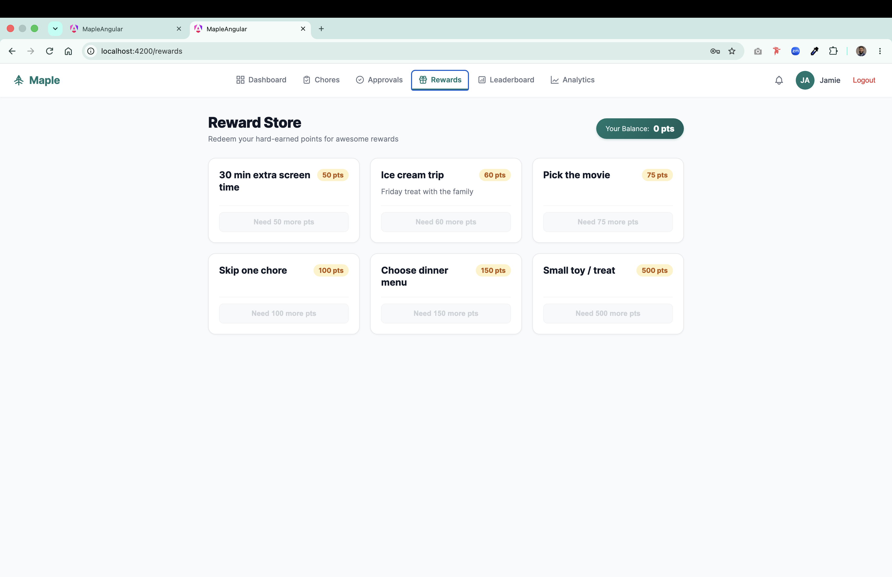

<div align="center">
  <h1>🍁 Maple — Family Chore & Reward Manager</h1>
  <p><b>Enterprise-Grade Full-Stack Household Productivity Platform & Gamified Reward Engine</b></p>

  <p>
    <a href="https://angular.io"></a>
    <a href="https://www.typescriptlang.org"></a>
    <a href="https://www.php.net"></a>
    <a href="https://www.mysql.com"></a>
    <a href="https://www.chartjs.org"></a>
    <a href="LICENSE"></a>
  </p>

  <p>
    <i>A modern, responsive full-stack web application engineered to streamline family household coordination, enforce accountability, and motivate children through auditable points ledgers and gamified rewards.</i>
  </p>
</div>

---

## 🎥 Video Walkthrough Demo

Watch the full walkthrough demonstration featuring user registration, dual-role workflows, the Kanban chore board, real-time points ledger transactions, dynamic family leaderboard, and Chart.js analytics.

https://github.com/user-attachments/assets/maple-walkthrough-demo

---

## 📱 App Screenshots

| Login & Authentication | Parent Executive Dashboard | Kanban Chore Board |
|:---:|:---:|:---:|
|  |  |  |

| Rewards Catalog Manager | Family Leaderboard | Analytics & Insights |
|:---:|:---:|:---:|
|  |  |  |

<div align="center">

### Mobile Responsive Layout (375px)


</div>

---

## 📖 Overview

**Maple** is a family task management app built for households where parents and children collaborate on chores. Parents create chores with point values, children complete them, and parents approve submissions to award points. Points can be redeemed for rewards — all tracked in a real-time leaderboard with analytics.

Built from scratch as a full-stack application with **Angular 17** (frontend) and **PHP 8.4** (backend) — no bloated third-party frameworks, no heavy scaffolds. Every line of the router, ORM layer, and authentication system is custom-crafted for reliability and speed.

### Why Maple?

- **Role-Based Access Control** — Parents manage chores, approve submissions, and curate rewards; children complete assignments and redeem points.
- **Append-Only Financial Ledger** — Every point change is recorded as an immutable `points_transactions` entry. Balances are calculated dynamically via `SUM(delta)`. No mutable balances, zero race conditions, full audit trail.
- **Real-Time Reactive Feedback** — Angular Signals propagate state updates instantly across dashboards, kanban boards, and navigation headers.
- **Household-Scoped Multi-Tenancy** — Clean data isolation scoped by household IDs with unique family invite codes.

---

## ✨ Core Features

### 🔐 Authentication & Household Multi-Tenancy
- Secure session-based authentication using **PHP native sessions** and **Bcrypt** password hashing.
- Register as parent, create a household, and share secure invite codes with family members.
- Instant login redirect to role-tailored dashboards (`parent` vs. `child`).

### ✅ Chore Management & Kanban Board
- **4-Stage Kanban State Machine**: `Not Started` ➔ `In Progress` ➔ `Submitted` ➔ `Approved`.
- Create and edit chores with titles, point weights, categories, and due dates.
- Assign chores to specific children with real-time status transitions.

### ⚖️ Two-Sided Verification & Approvals Workflow
- Children submit completed chores along with completion notes.
- Parents review submissions in a dedicated Approvals Queue.
- Approving awards points immediately; rejecting returns feedback so the child can address deficiencies.

### 🎁 Rewards System with Balance Protection
- Parent-managed reward catalog (full CRUD).
- Children browse available rewards with dynamic affordability indicators.
- Strict double-spend protection validates point balances at both frontend and backend before approving redemptions.

### 🏆 Family Leaderboard
- Family podium highlighting top performers with medals (🥇🥈🥉).
- Weekly velocity sparklines showing 7-day contribution momentum.
- Contextual "YOU" indicator distinguishing the logged-in family member.

### 📊 Analytics & Visual Intelligence
- **Weekly Chore Activity**: Bar chart tracking household completions by day.
- **Top Completed Chores**: Horizontal bar breakdown by task popularity.
- **Points Breakdown**: Doughnut chart showcasing point contributions across all members.

### 🎨 Design System
- **Curated Palette**: Deep Teal (`#0F766E`), Warm Amber (`#F59E0B`), and Slate neutrals designed in Figma.
- **Adaptive Breakpoints**: 375px (mobile), 768px (tablet), 1440px (desktop).
- **Accessible State Handling**: Standardized loading skeletons, informative empty states, and toast notifications.

---

## 🏗️ Architecture & Data Flow

```
┌────────────────────────────────────────────────┐
│           BROWSER (localhost:4200)             │
│                                                │
│  Angular 17 Single-Page Application (SPA)      │
│  • Standalone Components                       │
│  • Angular Signals for Reactive State          │
│  • Route Guards & Credentials Interceptors     │
│  • Chart.js for Data Visualizations            │
└──────────────────────┬─────────────────────────┘
                       │ HTTP + Cookies (SameSite=Lax, HttpOnly)
                       ▼
┌────────────────────────────────────────────────┐
│           PHP REST API (localhost:8000)        │
│                                                │
│  Router → Controllers → Services → Models      │
│  • AuthController (Sessions + Bcrypt)          │
│  • HouseholdController (Multi-tenancy)         │
│  • ChoreController & AssignmentController      │
│  • CompletionController (Verification Gate)    │
│  • RewardController & RedemptionController     │
│  • LeaderboardController & AnalyticsController │
│  • PointsService (Atomic Double-Entry Ledger)  │
└──────────────────────┬─────────────────────────┘
                       │ PDO Prepared Statements
                       ▼
┌────────────────────────────────────────────────┐
│               MySQL 8.0 (InnoDB)               │
│                                                │
│  users · households · household_members        │
│  chores · chore_assignments · chore_completions│
│  rewards · reward_redemptions                  │
│  points_transactions · notifications           │
└────────────────────────────────────────────────┘
```

### Key Design Decisions

- **Append-Only Ledger for Points:** Every point allocation or redemption is a discrete row in `points_transactions`. Balances are calculated dynamically using `SELECT SUM(delta) WHERE user_id = ?`. Eliminates balance desynchronization and maintains a full audit log.
- **Session-Based Authentication:** Employs secure, HTTP-only session cookies with `SameSite=Lax` instead of vulnerable localStorage JWTs.
- **Angular Signals:** Replaced traditional RxJS state boilerplate with fine-grained Angular 17 Signals for high performance and clean reactive code.
- **Role-Based Authorization:** Permissions are verified at the database level per household membership (`parent` or `child`).

---

## 🚀 Quick Start & Local Setup

### Prerequisites
- **Node.js**: `20.x` or higher — [Download](https://nodejs.org)
- **PHP**: `8.4+` (with `pdo_mysql` extension) — `brew install php` or [php.net](https://www.php.net)
- **MySQL**: `8.0+` — XAMPP, Homebrew, or [MySQL installer](https://dev.mysql.com/downloads/)
- **Composer**: `2.x` — [getcomposer.org](https://getcomposer.org)
- **Angular CLI**: `npm install -g @angular/cli`

### 1. Clone the Repository

```bash
git clone https://github.com/snaimio/maple.git
cd maple
```

### 2. Backend Configuration

```bash
composer install
cp .env.example .env
# Edit .env with your local MySQL credentials
```

### 3. Database Initialization & Seeding

```bash
# Create database
mysql -u root -e "CREATE DATABASE IF NOT EXISTS maple CHARACTER SET utf8mb4 COLLATE utf8mb4_unicode_ci;"

# Execute sequential migrations (001 through 010)
for f in migrations/*.sql; do mysql -u root maple < "$f"; done

# Seed realistic demo family data
php seeders/demo_family.php
```

**Pre-Loaded Demo Accounts:**
| Role | Email | Password | Context |
|---|---|---|---|
| **Parent** | `alex@maple.test` | `password123` | Full admin privileges, approval queue, analytics |
| **Child** | `jamie@maple.test` | `password123` | Assigned chores, active points, reward redemption |

### 4. Launch Development Servers

```bash
# Terminal 1 — Start PHP Backend
php -S localhost:8000 -t public

# Terminal 2 — Start Angular Frontend
cd frontend && npm install && npm start
```

Open **http://localhost:4200** in your browser to access the login page.

---

## 📁 Project Structure

```
maple/
├── frontend/                        # Angular 17 Single-Page Application
│   └── src/app/
│       ├── core/                    # Guards, interceptors, models, services
│       ├── features/                # Feature domains:
│       │   ├── auth/                # Split-screen login & registration
│       │   ├── household/           # Household creation & invite onboarding
│       │   ├── dashboard/           # Adaptive parent & child dashboards
│       │   ├── chores/              # 4-column Kanban board & chore modal
│       │   ├── completions/         # Parent verification & approvals queue
│       │   ├── rewards/             # Rewards store & catalog manager
│       │   ├── leaderboard/         # Dynamic family podium & sparklines
│       │   └── analytics/           # Chart.js data visualizations
│       └── app.config.ts            # Application providers & routing setup
├── public/                          # Public web root
│   └── index.php                    # Front controller & request router
├── src/                             # Backend core architecture (PSR-4 Maple\)
│   ├── Controllers/                 # REST API endpoints
│   ├── Core/                        # Framework engine: Router, Database, Auth, Request, Response
│   └── Services/                    # Domain logic (Atomic PointsService ledger)
├── migrations/                      # 10 sequential SQL migrations (001–010)
├── seeders/                         # Seed data scripts (demo_family.php)
├── docs/                            # Documentation, API contracts, ERD & screenshots
│   ├── API_CONTRACT.md              # REST API response specification
│   ├── erd.dbml                     # Database schema & entity relationships
│   └── screenshots/                 # Real application interface screenshots
├── composer.json                    # Composer dependencies & PSR-4 mapping
├── LICENSE                          # MIT License
└── README.md                        # Project documentation
```

---

## 🛠️ Technology Stack

| Layer | Technologies & Tools |
|---|---|
| **Frontend Framework** | **Angular 17** (Standalone Components, Signals, Control Flow Syntax) |
| **Language** | **TypeScript 5.x** (Strict Type-Checking Enabled) |
| **Data Visualization** | **Chart.js 4.x** + **ng2-charts** |
| **Backend Engine** | **PHP 8.4** (Framework-free, Lightweight Custom REST Router, PSR-4 Autoloading) |
| **Database** | **MySQL 8.0** (InnoDB Engine, Foreign Key Constraints, Transactions) |
| **Authentication** | Session-based cookies (`HttpOnly`, `SameSite=Lax`), **Bcrypt** password hashing |
| **Tooling & Build** | Angular CLI, NPM, Composer, Git |

---

## 📄 License

This project is licensed under the **MIT License** — see the [LICENSE](LICENSE) file for complete details:

```text
MIT License

Copyright (c) 2026 Sheikh Naim

Permission is hereby granted, free of charge, to any person obtaining a copy
of this software and associated documentation files (the "Software"), to deal
in the Software without restriction, including without limitation the rights
to use, copy, modify, merge, publish, distribute, sublicense, and/or sell
copies of the Software, and to permit persons to whom the Software is
furnished to do so, subject to the following conditions:

The above copyright notice and this permission notice shall be included in all
copies or substantial portions of the Software.

THE SOFTWARE IS PROVIDED "AS IS", WITHOUT WARRANTY OF ANY KIND, EXPRESS OR
IMPLIED, INCLUDING BUT NOT LIMITED TO THE WARRANTIES OF MERCHANTABILITY,
FITNESS FOR A PARTICULAR PURPOSE AND NONINFRINGEMENT. IN NO EVENT SHALL THE
AUTHORS OR COPYRIGHT HOLDERS BE LIABLE FOR ANY CLAIM, DAMAGES OR OTHER
LIABILITY, WHETHER IN AN ACTION OF CONTRACT, TORT OR OTHERWISE, ARISING FROM,
OUT OF OR IN CONNECTION WITH THE SOFTWARE OR THE USE OR OTHER DEALINGS IN THE
SOFTWARE.
```

---

## 👤 Author

**Sheikh Naim**  
- **GitHub**: [@snaimio](https://github.com/snaimio)  
- **Portfolio**: [snaimio.github.io](https://snaimio.github.io/)  
- **LinkedIn**: [linkedin.com/in/snaimio](https://www.linkedin.com/in/snaimio)
